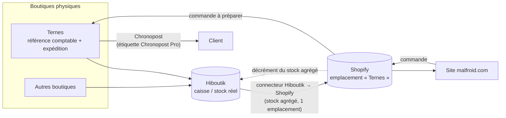
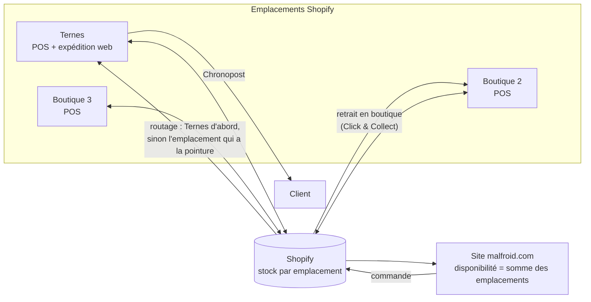

# Flux de stock — avant et après Shopify POS

## 1. Situation à la migration (conservée pour le lancement)

Principe retenu le 21/10 : un **stock agrégé** des boutiques est exposé sur le site ; la boutique
de **Ternes** sert de référence comptable et d'expédition. Pas de stock par site dans Shopify.

Points d'attention :

- une vente en boutique et une vente web peuvent consommer la même dernière paire : le
  connecteur doit synchroniser dans les deux sens, sinon risque de survente ;
- l'emplacement Shopify unique s'appelle « Ternes » pour que les commandes partent du bon point ;
- les 239 variantes créées à 0 sans SKU (Technique n° 10) doivent recevoir un SKU identique à
  Hiboutik avant que le connecteur ne les reconnaisse.

## 2. Cible après Shopify POS

Shopify POS remplace Hiboutik en caisse ; chaque boutique devient un **emplacement Shopify** avec
son propre stock, et le site vend sur la somme des emplacements (ou sur une sélection).

Ce que POS débloque :

- **Click & Collect** par boutique (Site n° 39) et affichage « disponible en boutique » sur la fiche ;
- **transferts** entre boutiques tracés dans Shopify ;
- comptabilité toujours centralisée sur Ternes si souhaité (rapports par emplacement) ;
- suppression du connecteur Hiboutik (Technique n° 20) et de l'abonnement associé.

Pré-requis : un abonnement POS Pro par boutique si plusieurs caisses, inventaire initial par
emplacement, et un routage des commandes paramétré dans Paramètres > Expédition > Priorité des
emplacements.
